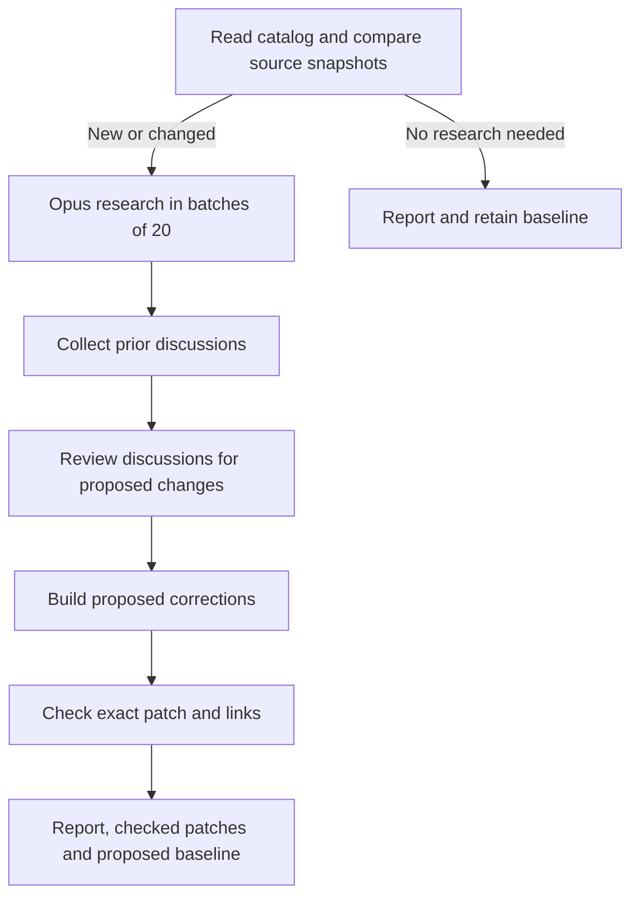

# Catalog freshness review

An opt-in workflow that checks whether catalog entries still match their projects.
Every run scans the full catalog; Opus researches only new or changed entries.
The report shows proposed diffs, evidence, and check results. Nothing is submitted
or applied automatically.

## Run in GitHub Actions

1. Merge the workflow into the default branch to enable manual runs.
2. Create an `awesome-space-review` environment with required reviewers and an
   `ANTHROPIC_API_KEY` secret.
3. Set repository variable `UM_FRESHNESS_ENABLED=true`.
4. Run **UM freshness review** on a reviewed branch.

Read the Actions summary and download `freshness-proposals`. It contains the
report, checked patches, evidence, validation logs, and a proposed `baseline.json`.
Review and commit that baseline as `.um/freshness/baseline.json` to save completed
reviews for the next run. Apply any catalog corrections separately.

Model calls use billable API access in Actions. Run frequency and spending policy
are up to the maintainer; this workflow has no automatic schedule or budget gate.
GitHub permissions are read-only, and checkout does not persist credentials.

## How it works



No completed reviews are bundled yet. The first run researches every entry with a
complete source snapshot; subsequent runs skip entries with saved, unchanged reviews. Unresolved findings and unavailable sources stay pending.
Only supported keep decisions with stable snapshots become completed reviews.
After accepting a correction, the corrected entry must be reviewed before it can
join the baseline. Adding or moving other entries does not invalidate a review.

Source snapshots watch repository identity, description, archive status, default
branch, READMEs, Markdown under `docs/`, and package manifests throughout GitHub
repositories. Crates.io entries also watch crate metadata and the linked GitHub
repository. Other sites use their final URL and page hash. Fetching and comparing
these snapshots needs no model. Changes confined to other source files can be
missed; cosmetic page changes can trigger extra reviews.

Proposed corrections are checked against prior issues and PRs, then checked for exact patch application and links with Lychee in a disposable checkout. Every URL on a changed entry must pass. Unrelated HTTP(S) failures that vary
between checks are reported separately; new local or unknown-scheme failures hold edits. Missing evidence,
uncertainty, incomplete history, failed checks, or a changed catalog hold the edit.
Checks do not establish factual correctness: maintainers still review the evidence.

History searches cover upstream and the fork, including discussion text and matched
PR diffs. Searches cannot find mentions that appear only in a diff. Collection is
bounded to 30 search matches per query, 10 discussions per candidate, 100 records
per detail endpoint, and limited evidence sizes; exceeding a limit holds the edit.

## Run locally

Install UM 0.72.1, Claude Code 2.1.284, Python 3.12+, and authenticated GitHub CLI.
Local runs can use existing Claude Code authentication. Install the validation tools:

```sh
bash .um/freshness/checks/install.sh
um workflow run --source-root .um/freshness --execution-root . \
  --run-dir /tmp/awesome-space-review-unique --json \
  .um/freshness/workflow.yaml
```

Use a unique run directory and avoid concurrent runs in the same checkout. Review
results before replacing the baseline, preserving any concurrent baseline updates.
To collect source snapshots alone, run `python3 .um/freshness/scripts/catalog.py`.
This writes `work/inventory.json`; snapshots are not completed reviews.

## Implementation and tests

Research runs Opus 5.5 at medium effort in sequential native UM batches of 20.
UM 0.72.1 has no dynamic loop node, so a command stage dispatches the batch workflow
and checks exact result coverage. History review uses the same model with tools
disabled and skips model calls when there are no corrections. The job timeout is
180 minutes; individual validation checks are limited to 180 seconds.

Research agents have normal tools, with instructions prohibiting external writes
and execution of project code. Those instructions are not an execution sandbox.
The eight workflow stages remain visible individually; the unchanged path runs only
preparation and reporting. Both paths export the same report, ZIP, and baseline.

CI covers correction, keep-only, and unchanged paths with synthetic inputs, offline
regressions, native batch exports, and real validation-tool fixtures. It makes no
model calls.

```sh
python3 -m unittest discover -s .um/freshness/tests -v
um workflow validate --source-root .um/freshness --json .um/freshness/workflow.yaml
```

Catalog layout is preserved. Compound entries are included in research, but their
corrections remain manual so a proposed edit cannot erase a companion resource.
No additional formatting or spelling policy is imposed. Maintainers review wording
and style against their contribution rules. External pages may change cosmetically
and trigger extra research.
